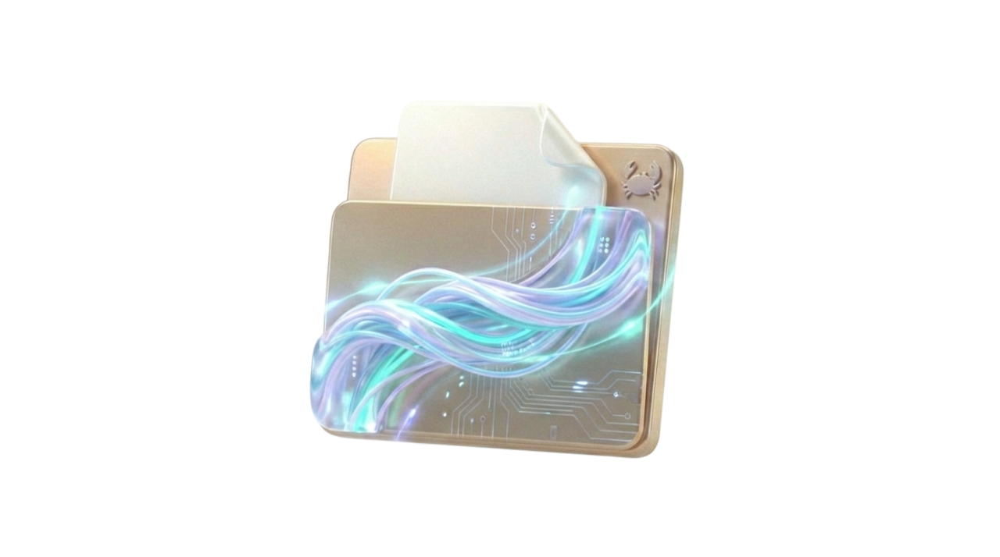
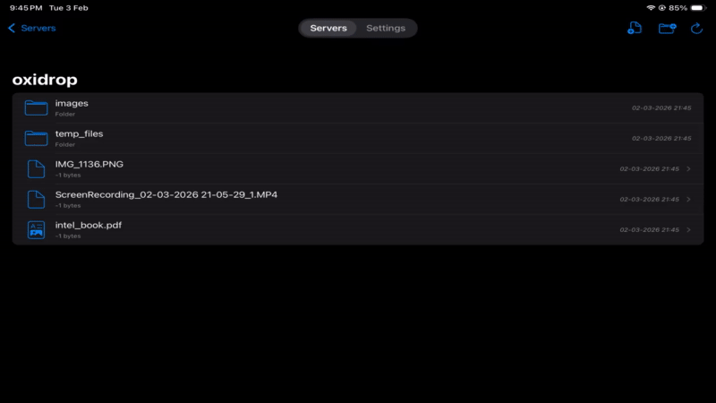

<div align="center">

  
  
  <h1>oxidrop</h1>
  
  <p>
    <b>Bridging the Gap Between Your Desk and Your Devices</b>
  </p>

  <a href="https://www.rust-lang.org/">
    
  </a>
    
    
    
  <a href="https://github.com/dhruvkshah75/oxidrop/releases/tag/v1.0.1">
    
  </a>
  <br>
  <br>
  <p>
  <a href="https://www.producthunt.com/products/oxidrop?embed=true&amp;utm_source=badge-featured&amp;utm_medium=badge&amp;utm_campaign=badge-oxidrop" target="_blank" rel="noopener noreferrer">
    
  </a>
  </p>
  <br>
</div>

## What is Oxidrop?

Oxidrop shares files between a Linux computer and nearby devices over a local network. The Go terminal file manager can launch an authenticated Samba server for iPad and iPhone Files. The Rust executable also runs the original WebDAV server for clients such as OwlFiles.

- [Build and install](#build-and-install)
- [Connect from iPad or iPhone](#connect-from-ipad-or-iphone)
- [Use the terminal file manager](#use-the-terminal-file-manager)
- [Configure Oxidrop](#configure-oxidrop)
- [Run the backend directly](#run-the-backend-directly)
- [Troubleshooting](#troubleshooting)
- [Development checks](#development-checks)

## Build and install

Use Linux, a current stable Rust toolchain with Cargo, Go 1.25 or newer, and Make. Install Samba with its `fruit` and `streams_xattr` VFS modules. On Debian and Ubuntu:

```sh
sudo apt install samba samba-vfs-modules
make build
./target/release/oxidrop-tui
```

`make build` invokes Cargo and Go through their incremental build caches. It produces `target/release/oxidrop` and `target/release/oxidrop-tui`. Run `make install-user` to install both in `~/.local/bin`, or run `sudo make install` after building to install both in `/usr/local/bin`. Once the destination is on your `PATH`, run `oxidrop-tui` from any directory.

Clipboard import uses `wl-paste` from `wl-clipboard` on Wayland or `xclip` on X11. Opening regular files uses `xdg-open`.

## Connect from iPad or iPhone

1. Put both devices on the same Wi-Fi network or connect them via a hotspot. The network must permit TCP 445 for SMB and local multicast for Bonjour discovery.
2. Launch `oxidrop-tui` as your regular Linux user. The TUI opens first and launches the compiled Rust backend. Approve the sudo prompt when asked to start its Samba instance.
3. Wait for **ONLINE**, then press **Alt+L** to see the session username and password. Each managed session generates a new password.
4. In **Files → Browse → … → Connect to Server**, enter `smb://oxidrop.local`. If the hostname fails, try `smb://LAN_IP` using the address in the TUI header.
5. Choose **Registered User**, enter the session credentials, then open the **oxidrop** share. Paste or create files inside that share.

The TUI owns the backend it starts. **Alt+Q** or **Ctrl+C** stops the managed Samba instance and withdraws its Bonjour announcement. Cargo runs only to build the backend when needed. If system Samba already owns TCP 445, the TUI cannot start a managed session.

## Use the terminal file manager

The left pane starts in the directory you launch from. The right pane displays the iPad share and refreshes when files change. The TUI sets the terminal window title to `oxidrop`. The interface uses charcoal panels, teal directory labels, coral focus, matching outer margins, and a stacked or single-pane layout in narrow terminals.

| Input | Action |
| --- | --- |
| Tab / Shift+Tab | Switch panes. |
| ↑ / ↓, Page Up / Page Down, mouse wheel | Browse entries. Clicking a row selects it for browsing or dragging. |
| Enter / →, ← | Open a folder or file, or go up a directory. The right pane stays inside the share. |
| Alt+G / Alt+U | Go to your home directory or filesystem root in the left pane. |
| Type, or Alt+/ | Search the active pane. Typing opens search immediately. |
| Backspace, Esc / Ctrl+U | Erase a search character or clear the query. |
| Alt+Enter | Reveal a file in its containing folder. |
| Ctrl+Space / Alt+A | Toggle one item or toggle all visible entries. |
| Alt+C / Alt+M | Copy or move selected entries, or the highlighted entry, into the opposite pane's current directory. |
| Drag a row across panes | Copy into the folder under the pointer or the destination pane's current directory. |
| Ctrl+V | Import desktop clipboard files or save an image into the active directory. |
| Ctrl+N / Alt+N, Ctrl+F | Create a folder or an empty file. |
| Delete / Alt+D | Request deletion. Confirm with Alt+Y or cancel with Alt+N or Esc. |
| Alt+R | Refresh both panes and rerun active searches. |
| Alt+L | Open server logs, transfer error details, and session credentials. |
| F1 / Alt+H | Open keyboard help. |
| Alt+Q / Ctrl+C | Quit and end the managed SMB session. |

Search is case-insensitive and matches filenames. Current-folder matches appear immediately. Nested matches stream in with relative paths. Search skips symbolic-link traversal, reports unreadable folders, and caps nested results at 1,000. You can copy or move a result directly.

Copy and move process selected items in the background. On a name collision, **Alt+O** overwrites, **Alt+S** or **Esc** skips, and **Alt+R** lets you enter a new name. The status area reports progress and results. Moves that require copying remove a source only after publishing the destination and checking that the source did not change during the copy.

Clipboard import supports local file paths and PNG, JPEG, WebP, GIF, BMP, and TIFF images. Dropping files from a desktop file manager works in terminals that send dropped paths as bracketed paste. Focus the right pane to import directly into the share.

## Configure Oxidrop

Create `~/.config/oxidrop/config.toml` for TUI overrides:

```toml
share_dir = "~/oxidrop-share"
server_binary = "~/.local/bin/oxidrop"
```

Both keys are optional. The share defaults to `~/oxidrop-share` and is created if missing. Relative paths are resolved from the configuration file's directory. Without an override, the TUI looks for the Oxidrop checkout from the current directory and executable location, checks for the backend beside the TUI or on `PATH`, and builds a missing release backend when it can locate the checkout.

## Run the backend directly

### SMB

```sh
sudo ./target/release/oxidrop --smb --share-dir "$HOME/oxidrop-share"
```

The standalone server prints session credentials and serves a writable `[oxidrop]` share with SMB2/SMB3 and Apple VFS support. It creates a private Samba configuration and runtime data for the session and advertises the share via Bonjour. SIGINT or SIGTERM stops managed Samba and removes the advertisement. `--managed-smb` requires an available port 445 and refuses to reuse an existing service. `--quiet` emits JSON lifecycle events for supervising programs.

### Reuse an existing system Samba service

Direct `--smb` mode can advertise a matching share on a running `smbd.service` or `smb.service`. System Samba remains responsible for the share after Oxidrop exits. Add the global options to the existing `[global]` section in `/etc/samba/smb.conf` and substitute your actual share path and user:

```ini
[global]
    server min protocol = SMB2_02
    fruit:nfs_aces = no
    vfs objects = fruit streams_xattr

[oxidrop]
    path = /home/alex/oxidrop-share
    read only = no
    browseable = yes
    valid users = alex
    fruit:metadata = stream
```

Use the system Samba account password. To set one, run `sudo smbpasswd -a alex`, then validate the configuration with `testparm -s` and reload the running Samba service.

### WebDAV

Run `oxidrop` without an SMB flag. Run `./setup.sh` to create `.env`, or set `AUTH_USERNAME`, `AUTH_PASSWORD`, `STORAGE_PATH`, and `PORT` through your environment. The setup script defaults to port 9090. The backend defaults to 8080 if `PORT` is absent. `--share-dir PATH` overrides `STORAGE_PATH`. Without either, the server uses `~/oxidrop-share`.

Connect using a WebDAV client and the configured credentials at `http://oxidrop.local:PORT/` or `http://LAN_IP:PORT/`. This endpoint uses HTTP Basic authentication without TLS, so use it on a trusted local network. WebDAV credentials are separate from Samba credentials.

## Troubleshooting

- **OFFLINE or TCP 445 already in use.** Press Alt+L for diagnostics. If system Samba is using the port and you can pause its other shares, run `sudo systemctl stop smbd` and reopen the TUI. The managed TUI session needs its own listener.
- **Invalid username or password.** Choose **Registered User** and use the credentials for the current Samba mode. For a managed session, use the current credentials under Alt+L.
- **Read Only in Files.** Open the **oxidrop** share itself before pasting. The server-level screen lists shares. For system Samba, use `testparm -s` to check `read only = no`, confirm that the authenticated Linux user can write to the backing directory, and reconnect after changing the configuration.
- **Input/output error after login.** Check the Samba service journal, Samba logs, and any matching AppArmor denials before changing permissions.

## Development checks

```sh
cargo test --locked
go -C tui test ./...
cargo test --locked smb_service_resolves_and_unregisters -- --ignored
```

The Bonjour integration test requires multicast access. The TUI tests exercise transfers, collision handling, live refresh, recursive search, clipboard import, pane layout, and mouse targets.

## Original WebDAV demo


